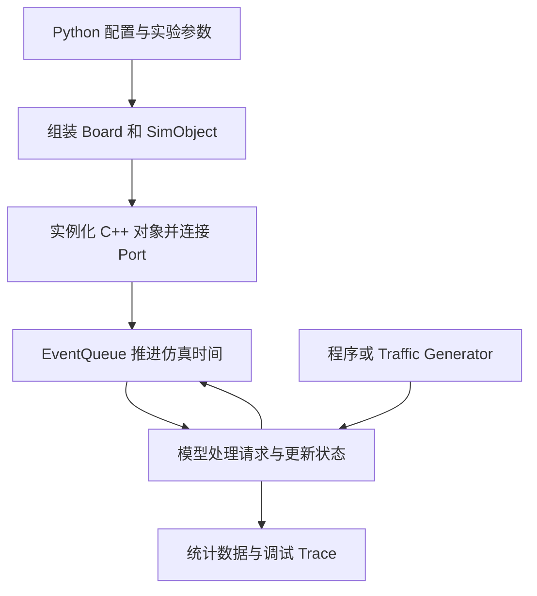
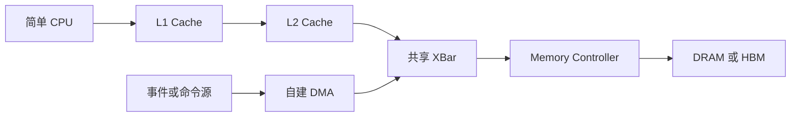

# gem5 官方仓库与 SoC 性能建模学习报告

核对日期：2026-10-11，北京时间。面向项目：`soc_model`。

本报告保留调研时的说明和建议。后续采用的项目目标与路线由 [项目上下文](project-context.md)维护，当前目录职责见 [项目入口](README.md)，选定版本与获取状态见 [上游登记](upstream/README.md)，实际进展见 [进度记录](records/PROGRESS.md)。本报告中的目录与命令建议不作为已实施状态。

**建议以官方 `gem5/gem5` 的固定 release 作为实验底座，完整保留该版本源码，按问题学习其中的模块。第一批配套资料选择 Bootcamp 2024 和官网文档；workload、内核、磁盘镜像按实验逐项获取。** 学习顺序采用“工具入门 → 通用模块与仿真原理 → 简单 SoC 实验 → SDMA 性能模型 → 更大的 SoC”。

官方仓库已经提供 DMA 基础设施、AMD GPU SDMA、TLB、Cache、互连和 DRAM 等模型，适合支撑这个方向。其中的模型抽象、固定延迟和实现范围需要逐项理解；预测目标硬件性能还需要对应参数及校准依据。

## 项目目标与前期讨论

本项目按本次明确的四个目标组织：

| 目标 | 对应的学习产出 |
| --- | --- |
| 学会使用 gem5 | 能配置、运行、调试仿真，解释输出，重复实验 |
| 理解官方工程和通用模块 | 能沿源码说明 SimObject、EventQueue、Port、Packet、CPU、Cache、Memory Controller 如何协作 |
| 用简单 SoC model 帮助 `soc_study` 学习 | 用可控实验说明模块作用，以及延迟、带宽、队列和反压对系统的影响 |
| 逐步研究 SDMA 和较大 SoC 性能 | 能定义建模粒度、实现关键资源约束、设计 workload，并用独立依据校准结果 |

已读取用户提供的 [ChatGPT gem5 分享对话](https://chatgpt.com/share/6acb58e5-f6a8-83e8-afba-015e3683b697)。用户在该会话中明确将其用于 gem5 专题讨论；此前回答形成了以下研究方向与建议，本次以用户新提出的四个目标将其具体化：

- 从芯片架构与性能分析的角度学习，理解请求流动、资源竞争、时序与统计。
- 掌握 SimObject、EventQueue、Port、Packet，再进入 Cache、Ruby、Garnet 和 Memory Controller。
- 结合 SDMA、GPUVM、TLB、IOMMU/ATS、HBM，逐步分析模块之间的性能交互。
- 早期可从 Garnet Router 的 VC、credit、仲裁、Buffer 和反压切入；这是此前回答的学习建议，本次将它保留为基础入门后的 NoC 实验支线。
- 保留常用英文术语，结合源码与架构图，并区分官方实现、建模假设和目标验证。

分享对话中的技术介绍作为接续背景；本报告的版本、目录和关键 SDMA 实现重新按官方来源核对。`soc_study` 现有索引中的 TLB、page walker、请求合并来源，可在相应实验阶段按问题复用。

## 官方仓库与版本基线

| 项目 | 本次核对结果 | 对本项目的意义 |
| --- | --- | --- |
| 主仓库 | [gem5/gem5](https://github.com/gem5/gem5) | 模拟器源码、配置脚本、测试和构建工具 |
| 默认分支 | `stable` | 入门可从正式发布版本开始 |
| 开发分支 | `develop` | 后续核查新特性、补丁和上游变化 |
| 最新正式 release | [v25.1.0.1](https://github.com/gem5/gem5/releases/tag/v25.1.0.1) | 本报告源码核对与建议实验的版本基线 |
| 对应 commit | [`c8222cc67a399bfc01e8658dd14b30d5bfd634f9`](https://github.com/gem5/gem5/commit/c8222cc67a399bfc01e8658dd14b30d5bfd634f9) | 固定实验身份，避免分支更新后结果难以比较 |
| 发布时刻 | 2026-04-22 02:37:49，北京时间 | GitHub API 原始时间为 2026-04-21 18:37:49 UTC |
| 主要实现方式 | C++ 模型与仿真内核、Python 配置及 standard library、SCons 构建 | 初期主要写 Python，深入模型时读写 C++ |
| 主仓库许可证标识 | BSD-3-Clause | 保留许可证；附带代码和外部组件仍按各自版权声明处理 |

版本与时间来自 [GitHub release API](https://api.github.com/repos/gem5/gem5/releases/latest)，tag 与 commit 的对应关系来自 [Git ref](https://api.github.com/repos/gem5/gem5/git/ref/tags/v25.1.0.1)。正式实验固定 tag 和 commit；`stable`、`develop` 都属于会变化的引用。

本次读取到的 `stable` HEAD 是 [`f5c5a6e390f55dd5984977815bf9d0bd05da6945`](https://github.com/gem5/gem5/commit/f5c5a6e390f55dd5984977815bf9d0bd05da6945)，与上述 release tag 不同。因此，即使下载时选择 `stable`，也应记录实际 commit，不能仅用分支名标识实验版本。

## gem5 怎样完成一次仿真

gem5 是模块化的计算机体系结构仿真平台。对本项目而言，最值得掌握的是：**把体系结构问题变成一组有状态、有接口、有资源限制、随仿真时间推进的对象，再观察 workload 通过这些对象的过程。** 官方的 [standard library 概述](https://www.gem5.org/documentation/gem5-stdlib/overview)介绍了 Board、Processor、Cache Hierarchy 和 Memory 的组合方式。



一次典型运行包括以下过程：

1. **构建模拟器。** SCons 按构建配置选择 ISA、协议和功能，生成 `gem5.opt` 等可执行文件。
2. **执行 Python 配置。** 设置频率、内存地址范围、CPU 或流量源、Cache、互连、内存和 workload。standard library 可以减少重复的组装工作。
3. **实例化 SimObject。** Python 参数传到 C++ 模型，建立对象和端口连接；底层入口包括 `m5.instantiate()`。
4. **进入事件循环。** `m5.simulate()` 或 standard library 的 `Simulator` 驱动运行。事件在指定 Tick 发生，模型据此修改状态并安排后续事件。
5. **发送请求并处理返回。** 例如一个读请求经 Cache、互连到达内存控制器，完成后返回数据；等待、排队和资源占用由相应模型体现。
6. **结束指定测量区间。** 保存统计及配置，分析性能变化的原因。

源码入口分别是 [`src/sim/`](https://github.com/gem5/gem5/tree/v25.1.0.1/src/sim)、[`src/mem/port.hh`](https://github.com/gem5/gem5/blob/v25.1.0.1/src/mem/port.hh)、[`src/mem/packet.hh`](https://github.com/gem5/gem5/blob/v25.1.0.1/src/mem/packet.hh) 和 [`src/python/gem5/`](https://github.com/gem5/gem5/tree/v25.1.0.1/src/python/gem5)。

### 两组需要分清的概念

| 维度 | 选项 | 适合回答的问题 |
| --- | --- | --- |
| workload 与系统环境 | Traffic Generator | 不执行应用程序，直接施加可控访存流量，研究内存和互连 |
| workload 与系统环境 | SE，Syscall Emulation | 执行用户程序，由模拟器处理系统调用，适合初期 CPU 与 Cache 实验 |
| workload 与系统环境 | FS，Full System | 执行 OS 和系统软件，研究驱动、设备交互、中断及完整软件栈 |
| 内存访问方式 | Timing | 显式处理请求、返回、接纳失败和 retry，适合研究竞争、反压和性能 |
| 内存访问方式 | Atomic | 同步完成访问并返回估计延迟，通常用于较快的执行或准备阶段 |
| 内存访问方式 | Functional | 直接访问数据，常用于加载、检查和调试，不体现竞争时序 |

SE 和 FS 描述的是运行环境，Timing、Atomic、Functional 描述的是访问方式；两者不是同一组选项。早期性能实验优先使用 Timing，并检查研究路径是否实际经过相关时序模型。Timing Port 的 retry 规则可直接从 [`timing.hh`](https://github.com/gem5/gem5/blob/v25.1.0.1/src/mem/protocol/timing.hh)理解；另见 [`atomic.hh`](https://github.com/gem5/gem5/blob/v25.1.0.1/src/mem/protocol/atomic.hh)和 [`functional.hh`](https://github.com/gem5/gem5/blob/v25.1.0.1/src/mem/protocol/functional.hh)。

## 主仓库中值得优先学习的内容

下表的优先级表示学习顺序。主仓库下载时仍建议保留完整源码树。

| 优先级 | 目录或文件 | 学习重点 | 与本项目的联系 |
| --- | --- | --- | --- |
| 第一批 | [`configs/example/gem5_library/`](https://github.com/gem5/gem5/tree/v25.1.0.1/configs/example/gem5_library) | standard library 的实际运行脚本 | 最快建立能重复运行的实验 |
| 第一批 | [`src/python/gem5/components/`](https://github.com/gem5/gem5/tree/v25.1.0.1/src/python/gem5/components) | Board、Processor、Cache Hierarchy、Memory 的组合接口 | 组装自己的简单 SoC model |
| 第一批 | [`configs/learning_gem5/`](https://github.com/gem5/gem5/tree/v25.1.0.1/configs/learning_gem5)与 [`src/learning_gem5/`](https://github.com/gem5/gem5/tree/v25.1.0.1/src/learning_gem5) | 简单配置、自定义 SimObject、memory object、简单 Cache | 从会使用推进到会扩展模型 |
| 第一批 | [`src/sim/`](https://github.com/gem5/gem5/tree/v25.1.0.1/src/sim) | SimObject、EventQueue、ClockDomain、System、统计和 checkpoint | 理解全工程的运行骨架 |
| 第一批 | [`src/mem/`](https://github.com/gem5/gem5/tree/v25.1.0.1/src/mem)中的 `request.hh`、`packet.hh`、`port.hh`、`protocol/` | 请求身份、数据传递、接纳与 retry | 后续所有 DMA、Cache、互连模型的共同基础 |
| 第一批 | [`src/cpu/testers/traffic_gen/`](https://github.com/gem5/gem5/tree/v25.1.0.1/src/cpu/testers/traffic_gen) | 可控流量、请求间隔、访问模式 | 将系统性能问题与复杂应用行为分开研究 |
| 第一批 | [`src/mem/cache/`](https://github.com/gem5/gem5/tree/v25.1.0.1/src/mem/cache) | Cache 命中、miss、MSHR、替换与预取 | 理解缓存容量、并发 miss 和下游压力 |
| 第一批 | [`src/mem/XBar.py`](https://github.com/gem5/gem5/blob/v25.1.0.1/src/mem/XBar.py)及 `xbar`、`bridge` 实现 | 互连宽度、延迟、转发与反压 | 建立可控的共享访存路径 |
| 第一批 | [`src/mem/MemCtrl.py`](https://github.com/gem5/gem5/blob/v25.1.0.1/src/mem/MemCtrl.py)、`DRAMInterface.py`、`HBMCtrl.py` | 控制器队列、读写调度、DRAM 时序和通道组织 | 对接 UMC、HBM 的学习主题 |
| 第二批 | [`src/dev/dma_device.hh`](https://github.com/gem5/gem5/blob/v25.1.0.1/src/dev/dma_device.hh)及 `.cc` | DmaDevice、DmaPort、拆分请求、完成回调、DmaReadFifo | 实现最小 DMA 性能模型 |
| 第二批 | [`src/dev/pci/CopyEngine.py`](https://github.com/gem5/gem5/blob/v25.1.0.1/src/dev/pci/CopyEngine.py)及 `copy_engine.cc` | 已有 PCI copy engine 的通道、描述符与搬运流程 | 参考一种具体 DMA 设备组织方法 |
| 第二批 | [`src/dev/amdgpu/`](https://github.com/gem5/gem5/tree/v25.1.0.1/src/dev/amdgpu) | SDMA、GPUVM、系统 hub、interrupt handler、MMIO | 逐步连接 SDMA、HUBS、IH 等学习主题 |
| 第二批 | [`src/arch/amdgpu/vega/`](https://github.com/gem5/gem5/tree/v25.1.0.1/src/arch/amdgpu/vega) | TLB、coalescer、page walker | 对照 UTCL1、UTCL2 的机制问题 |
| 第二批 | [`src/mem/ruby/network/garnet/`](https://github.com/gem5/gem5/tree/v25.1.0.1/src/mem/ruby/network/garnet)与 [`garnet_synth_traffic.py`](https://github.com/gem5/gem5/blob/v25.1.0.1/configs/example/garnet_synth_traffic.py) | Router、路由、VC、credit、Buffer 和仲裁 | 接续此前讨论，尽早开展独立 NoC 实验 |
| 第三批 | [`src/mem/ruby/`](https://github.com/gem5/gem5/tree/v25.1.0.1/src/mem/ruby) | 一致性状态机、Directory、消息队列与网络协作 | 将独立组件扩展为较完整的共享内存系统 |
| 按问题进入 | [`src/cpu/`](https://github.com/gem5/gem5/tree/v25.1.0.1/src/cpu)与 [`src/arch/`](https://github.com/gem5/gem5/tree/v25.1.0.1/src/arch) | TimingSimple、Minor、O3 与 ISA 行为 | 当 CPU 供给能力或指令执行成为研究变量时深入 |
| 持续使用 | [`tests/`](https://github.com/gem5/gem5/tree/v25.1.0.1/tests)、[`util/`](https://github.com/gem5/gem5/tree/v25.1.0.1/util)、`src/base/stats/` | 回归测试、辅助工具、统计机制 | 维护模型正确性与实验可重复性 |

构建还需要根目录 `SConstruct`、`build_opts/`、`build_tools/`、`site_scons/`、`ext/`、`include/` 及各目录 `SConscript`。因此，单独摘取 SDMA 或内存控制器的几个 C++ 文件适合阅读，不能作为完整可构建工程。[主仓库说明](https://github.com/gem5/gem5/blob/v25.1.0.1/README.md)

Classic Cache 路线适合先研究缓存和访存瓶颈；当问题涉及具体一致性协议状态、Directory、网络流控时，再进入 Ruby 与 Garnet。两条路线各有适用问题，不宜把它们当作只需替换一个开关就可保持所有行为相同的实现。[Ruby 文档](https://www.gem5.org/documentation/general_docs/ruby/)、[Garnet 文档](https://www.gem5.org/documentation/general_docs/ruby/garnet-2/)

## 官方 SDMA 模型的价值和性能边界

**官方 gem5 已有 AMD GPU 的 `SDMAEngine`，无需从零开始寻找相关实现。** 首要入口是 [`sdma_engine.hh`](https://github.com/gem5/gem5/blob/v25.1.0.1/src/dev/amdgpu/sdma_engine.hh)、[`sdma_engine.cc`](https://github.com/gem5/gem5/blob/v25.1.0.1/src/dev/amdgpu/sdma_engine.cc)、`sdma_packets.hh`、`sdma_commands.hh` 和 `AMDGPU.py`。

这个实现值得学习队列与 RPTR/WPTR 的关系、doorbell 触发、命令取回及解析、copy、write、indirect buffer、fence、trap，以及 host memory 和 device memory 路径的处理。它继承 `DmaVirtDevice`，能帮助理解命令处理如何衔接地址转换与 DMA 访问。

本次对固定版本源码的选读发现了几项会直接影响性能建模的事实：

| 源码事实 | 对性能研究的含义 |
| --- | --- |
| `sdma_engine.hh` 第 174 行定义 `sdma_delay = 1e9` Tick；命令取回及部分数据读取传入该值 | 需要追踪延迟的实际施加位置与 Tick 时间尺度，不能把它直接当成目标 SDMA 硬件参数 |
| `copy()` 发起源数据读取，读完成后经 `copyReadData()` 发起目的写入 | 应审查读写重叠粒度；若目标引擎具有细粒度流水或多笔并发，需要显式建模 |
| `getDeviceAddress()` 使用 functional translation 判断地址属于 host 还是 device memory | 该步骤不能直接代表目标 TLB、page walker 的排队和时序；完整翻译路径还要单独追踪 |
| 多个 tiled copy 等命令分支进入 `panic`，部分命令为 `warn` | 用例须与已实现的命令范围对应，不能从名称推定支持完整 SDMA 功能 |

对应定位：[固定延迟](https://github.com/gem5/gem5/blob/v25.1.0.1/src/dev/amdgpu/sdma_engine.hh#L174)、[copy 路径](https://github.com/gem5/gem5/blob/v25.1.0.1/src/dev/amdgpu/sdma_engine.cc#L706)、[地址判定](https://github.com/gem5/gem5/blob/v25.1.0.1/src/dev/amdgpu/sdma_engine.cc#L120)、[命令分支](https://github.com/gem5/gem5/blob/v25.1.0.1/src/dev/amdgpu/sdma_engine.cc#L397)。

**据此，建议将现有 AMD SDMA 用作功能流程和系统连接的参考，同时从较小的 DMA timing model 开始建立性能分析能力。** 待能够解释 outstanding、FIFO、读写并行度和内存竞争以后，再决定扩展官方 `SDMAEngine`，还是维护面向目标 SDMA 的独立模型。

较小模型首先应显式控制：命令处理开销、请求粒度、最大 outstanding 数、读写 FIFO 容量、发射速率、完成条件和反压。随后按问题加入翻译、多个队列、仲裁、中断及 coherent/non-coherent 路径。这样可以区分“搬运引擎内部限制”与“下游内存限制”。这些是本项目的建模建议，不是官方 SDMA 已具备上述参数的声明。

## 与 soc_study 的对应方式

下面是学习主题的对应关系，不能据此推断目标 SoC 的模块包含关系或连接拓扑。

| `soc_study` 学习主题 | 可使用的 gem5 对象或机制 | 可以设计的实验 |
| --- | --- | --- |
| GL2 与缓存 | Classic Cache，后续 Ruby Cache | 容量、相联度、MSHR 数与 miss latency 如何影响吞吐 |
| UMC 与 HBM | MemCtrl、DRAMInterface、HBMCtrl、HBM 配置 | 顺序与随机访问、读写比例、通道数和地址交织的影响 |
| SWITCH | XBar 起步，后续 Garnet | 多个 initiator 竞争，宽度、VC、credit 与拥塞的关系 |
| DF 与 CS | 地址路由、交织、Cache/Directory、网络组件的组合 | 构造简化 fabric，研究目标选择和不同流量之间的竞争 |
| UTCL1 与 UTCL2 | Vega TLB、coalescer、page walker，或自建简化翻译模型 | TLB 容量、页大小、miss 并发和 page walk 成本 |
| HUBS 与 IH | AMDGPU 的 system hub、地址转换和 interrupt handler 相关实现 | 地址空间交接、请求完成、通知与软件可见完成的区别 |
| SDMA | DmaPort、DmaReadFifo、CopyEngine、SDMAEngine | 搬运长度、并发度、读写重叠和内存竞争对有效带宽的影响 |

其中 DF、CS、HUBS 等目标模块不一定存在同名且等价的 gem5 模型。需要先写清目标模块的职责和实验关心的约束，再组合或扩展通用组件。原有 `soc_study` 来源笔记继续在原项目维护，本项目记录实验配置、假设与结果。

## 值得下载到本地的官方内容

| 顺序 | 官方项目或资源 | 建议保留范围 | 下载策略 |
| --- | --- | --- | --- |
| 第一批 | [gem5/gem5](https://github.com/gem5/gem5) | 固定 release 的完整工作树，包括源码、配置、测试和构建文件 | shallow clone 指定 tag，先不获取全部历史；以后需要追踪变更再补历史 |
| 第一批 | [gem5bootcamp/2024](https://github.com/gem5bootcamp/2024) | `materials/01-Introduction`、`02-Using-gem5`、`03-Developing-gem5-models`，对应 `slides/`，以及阅读时需要的图片 | 按教程目录选择；初期不初始化其中的 gem5 与 gem5-resources submodule |
| 第一批配套 | [gem5/website](https://github.com/gem5/website) | `_pages/documentation/`，尤其 `gem5-stdlib`、`learning_gem5`、`general_docs`；相关图像按引用补充 | 可 sparse checkout；本地阅读 Markdown 不需要搭建 Jekyll 网站 |
| 按实验增加 | [gem5/gem5-resources](https://github.com/gem5/gem5-resources) | 需要自行编译或修改 workload 时，对应的源码与构建说明 | 可先保存源码仓库；不将资源仓库与全部预编译资源混为一谈 |
| 按实验增加 | [resources.gem5.org](https://resources.gem5.org/) | 当前实验需要的一个程序、kernel、disk image 或 checkpoint | 记录 resource ID、resource version 和兼容性；由 `obtain_resource` 等机制按需取得 |
| GPU 阶段 | Bootcamp 的 `04-GPU-model`、GPU workload、相匹配的系统镜像与软件栈 | 实际选定 GPU 实验所需内容 | 在进入 GPU FS 后取得，避免早期引入庞大环境依赖 |

`gem5bootcamp` 是官方文档链接的教学组织，主模拟器仓库仍是 `gem5/gem5`。官网文档入口目前推荐 Bootcamp 2024，同时明确提醒 Learning gem5 的部分内容已经过时；因此应把教程与固定 release 的脚本、API 一起核对。[官方学习入口](https://www.gem5.org/documentation/)

Bootcamp 2024 的 README 标注基于 v24.0，仓库还包含固定 revision 的 submodule；不能假设全部练习在 v25.1.0.1 下无需调整。首轮主要借用讲解顺序和小实验，执行脚本优先参照主仓库当前固定版本。[Bootcamp README](https://github.com/gem5bootcamp/2024/blob/main/README.md)

`gem5-resources` 提供资源的源码和构建材料，许多编译好的文件另外分发。当前官方机制支持通过资源 ID 与版本取得兼容资源；下载源码仓库不等于下载了所有磁盘镜像。[资源说明](https://www.gem5.org/documentation/general_docs/gem5_resources/)

### 第一阶段可以暂缓的内容

- 全部 Git 历史、各年份教程的重复源码副本和所有示例资源。
- 完整 Linux/GPU 磁盘镜像、大型 benchmark 和预生成 checkpoint，直到实验确实需要它们。
- SystemC、SST 和外部 DRAM 模拟器的安装与集成，直到内置模型无法回答具体问题。
- O3 CPU、GPU execution pipeline 的全面源码阅读，直到相关执行行为成为模型瓶颈或研究变量。

这里“暂缓”针对额外下载、构建和学习投入；主仓库内已经随完整源码取得的相关目录仍予保留。

## 建议的实验路线

| 阶段 | 最小实验 | 需要真正掌握的内容 | 完成标志 |
| --- | --- | --- | --- |
| 1 工具与输出 | 运行官方内存流量示例及一个 SE Hello World | 构建、配置、workload、运行目录、统计 | 能重跑，并区分仿真时间与宿主机耗时 |
| 2 内存与互连 | Traffic Generator → Memory，随后增加共享互连 | 请求大小、注入速率、读写比例、访问分布 | 能解释带宽饱和及延迟变化 |
| 2A NoC 实验支线 | Garnet Synthetic Traffic → Router/Link 网络 | VC、credit、Buffer、仲裁和注入率 | 能解释网络饱和点及排队延迟，接续原会话的 Switch 学习建议 |
| 3 简单 SoC | CPU → L1/L2 → XBar → Memory Controller → DRAM | Cache miss、并发访存、共享资源竞争 | 能通过对照实验解释各模块的作用 |
| 4 通用 DMA | 事件或简单命令源 → DMA → Memory | 分段请求、outstanding、FIFO、回调和 retry | 数据正确，完成语义明确，性能变化可解释 |
| 5 SDMA | 队列 → 取指/解析 → 读写流水 → 内存 | 多队列、命令开销、读写重叠、翻译与通知 | 能区分引擎瓶颈、翻译瓶颈和内存瓶颈 |
| 6 较大 SoC | 多 initiator、多通道、选定的一致性与网络模型 | 流量竞争、拓扑、QoS、软件驱动影响 | 模型范围和校准误差明确，结论可重复 |

NoC 支线可从小规模 Mesh 和 uniform random 流量开始，改变注入率、VC 数及 Buffer 深度，观察延迟与饱和吞吐。Garnet Synthetic Traffic 有独立的流量源和协议配置，与前述内存流量发生器分别配置；需要匹配该实验的构建选项。后续涉及异构 link width、Clock Domain、CDC 和 SerDes 时，再学习 HeteroGarnet，并为目标链路补充必要约束。[Synthetic Traffic 文档](https://www.gem5.org/documentation/general_docs/ruby/garnet_synthetic_traffic/)、[HeteroGarnet 文档](https://www.gem5.org/documentation/general_docs/ruby/heterogarnet/)

第一阶段的 [`memory_traffic.py`](https://github.com/gem5/gem5/blob/v25.1.0.1/configs/example/gem5_library/memory_traffic.py)已经提供 linear/random generator、读流量比例和 HBM 示例，无需先启动 Linux。它的默认配置是 generator 直接连接 memory，没有默认经过 XBar 或 Cache；研究后两者时需要显式加入。

该示例使用的 [`TestBoard`](https://github.com/gem5/gem5/blob/v25.1.0.1/src/python/gem5/components/boards/test_board.py)也不提供 DMA port、I/O bus 和 PCI bus。进入 DMA 阶段需要使用适合的 Board，或建立自己的 System/Board 连接，不能只在该示例中添加一个对象就认为 DMA 路径已经连通。

下面是建议逐步建立的教学模型。DMA 走共享互连还是 coherent 路径，应由实验假设明确；图中仅表示一种简化方案。



## 本地组织与起步命令建议

建议把上游源码、本项目模型、实验和结果分开维护：

```text
soc_model/
  gem5-official-repo-report.md
  upstream/
    gem5/
    gem5-bootcamp-2024/
    gem5-website/
    gem5-resources/
  models/       本项目编写的 C++ 与 Python SimObject
  configs/      本项目的系统配置
  experiments/  workload、参数组合和运行脚本
  results/      按实验保存的配置、统计和分析
  notes/        学习笔记与模型假设
```

该目录结构是后续实施建议。上游源码采用独立 Git checkout 或明确的版本锁定方式；本项目自己的 Git 管理不应无意中重复纳入整个上游历史、大型镜像和构建产物。新增模型可评估 SCons 的 `EXTRAS` 机制，具体集成方式随模型依赖确定。[构建与 EXTRAS 文档](https://www.gem5.org/documentation/general_docs/building)

官方构建文档以 Linux 为主要环境，并定期测试 Ubuntu 22.04 和 24.04。针对当前 Windows 工作区，建议后续评估 WSL2 中的 Ubuntu 24.04，或已有 Linux 主机；这是本项目的环境建议，尚未检查本机 WSL、依赖和硬件资源。编译源码与构建产物优先放 Linux 文件系统，报告和学习笔记可继续放当前项目。

以下命令用于说明后续最小起步方式，本轮没有执行下载或构建。应先按官方文档完成 Linux 构建依赖安装，再在选定的工作目录中执行：

```bash
git clone --depth 1 --branch v25.1.0.1 https://github.com/gem5/gem5.git upstream/gem5
git -C upstream/gem5 rev-parse HEAD
cd upstream/gem5
scons build/RISCV/gem5.opt -j 2
./build/RISCV/gem5.opt -d m5out/memory-linear configs/example/gem5_library/memory_traffic.py LinearGenerator 100
./build/RISCV/gem5.opt -d m5out/memory-random configs/example/gem5_library/memory_traffic.py RandomGenerator 100
```

预期 Git revision 为 `c8222cc67a399bfc01e8658dd14b30d5bfd634f9`。`RISCV` 是初期 CPU 与内存学习的一种构建选择，流量发生器本身不执行 RISC-V 指令。官方文档也推荐覆盖广泛功能的 `build/ALL/gem5.opt`；选择 `ALL` 会增加构建范围，后续按所需 ISA、GPU 与 Ruby 协议确定。`-j 2` 仅是较保守的示例并行度，不代表已验证适合本机。[构建选项](https://github.com/gem5/gem5/tree/v25.1.0.1/build_opts)

## 性能结论需要保留的依据

每个实验至少保存 gem5 commit、本项目模型修改、配置脚本、workload 身份与版本、运行命令、实际对象配置、随机种子和测量区间。默认输出中的 `config.ini`、`config.json`、`stats.txt` 可以用于核实实际配置和统计；性能比较使用相同定义的测量区间。[输出与统计说明](https://www.gem5.org/documentation/learning_gem5/part1/gem5_stats/)

初期重点观察有效带宽、请求时延、完成的数据量、队列占用、outstanding、retry/阻塞时间和各通道利用情况。并非所有模型都已经提供全部指标，必要时应在相应模型增加统计。DMA 的有效拷贝带宽按“完成拷贝的有效字节数 / 测量时间”计算；共享内存路径可能同时承担读和写，不能把总读写流量直接当作有效拷贝量。

验证按三个层次推进：先确认数据与命令完成语义正确；再用可手算的小例子和带宽/延迟约束检查模型；最终用目标规格、实测或 RTL 数据校准具体性能。统计数字精确到很多位，只说明模拟器进行了确定的计算，目标预测的可信度仍由模型与校准依据决定。

**本轮交付范围：已读取 ChatGPT“gem5”分享对话，完成官方仓库、固定版本、关键目录、代表性源码与配套资料的调研报告。尚未 clone 上游仓库、编译或运行仿真；所列命令经过对应源码入口核对，未做本机运行验证。**
