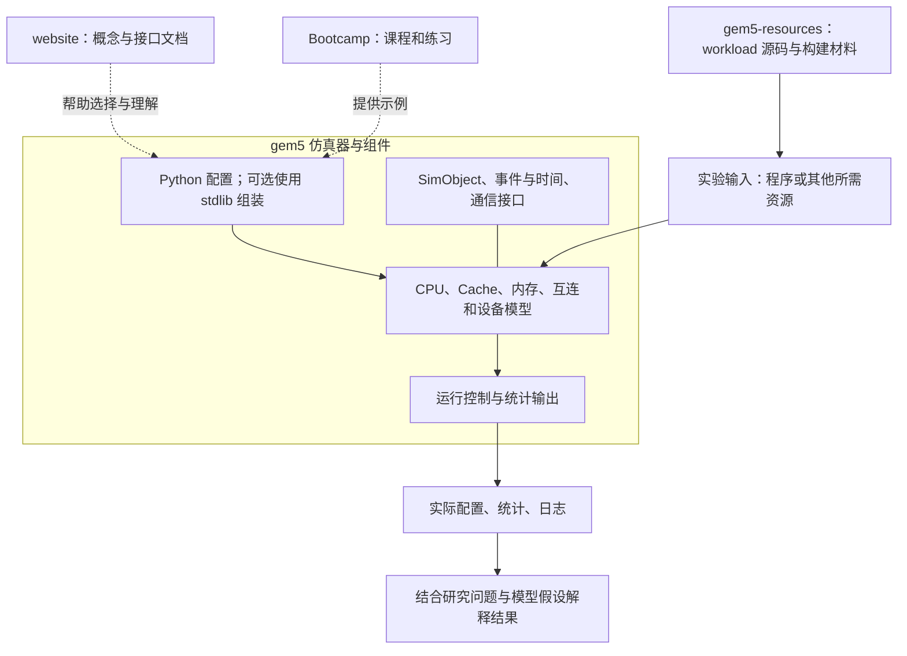
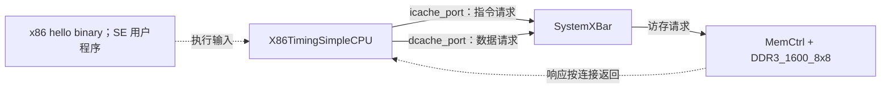
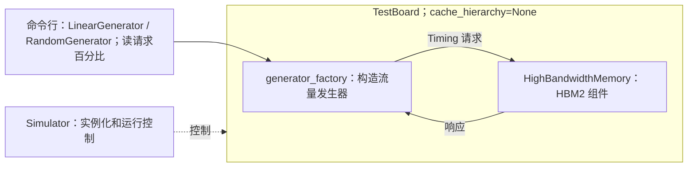

# gem5 整体认识工作笔记

整理日期：2026-10-12。状态：临时研究记录，已按分别修订的两份计划补充，待审阅。

当前关注 gem5 的整体构成、主要特征及其对 SoC 性能建模的意义。研究范围按 [gem5 研究计划](../plans/gem5-research-plan.md)推进，运行和实验按独立的 [项目工作开展计划](../plans/project-work-plan.md)推进。先理解各部分的用途和联系，只选读少量关键源码；本笔记的正式文件组织仍待讨论。

本文记录资料与源码阅读得到的认识，尚无编译或仿真实验结果。源码阅读快照为 gem5 `v25.1.0.1`，commit `c8222cc67a399bfc01e8658dd14b30d5bfd634f9`；现行版本与获取状态统一见 [上游登记](../gem5-official/README.md)。六个固定版本工作树的详细目录表见 [仓库目录导读](../notes/gem5-repository-map.md)。文中“本地源码”和“本地讲义”指旧电脑在整理日期的阅读副本；当前 Mac 尚未取得这些依赖，相对链接需在取得对应版本后使用。

## gem5 是怎样一种工具

gem5 是一个模块化、离散事件驱动的计算机系统仿真平台。研究者选择已有模型、设置参数和连接关系，再给系统提供 workload，由仿真器执行并输出统计。组件也可以按研究问题扩展或替换。[官方介绍](https://www.gem5.org/documentation/learning_gem5/introduction/)

因此，理解 gem5 需要同时看到两层：一层是事件、时间、对象和运行控制等仿真基础机制；另一层是 CPU、Cache、内存、互连和设备等被模拟的系统组件。配置脚本把这些组件组织为一个具体的研究对象。

Python 主要承担配置、组装和运行控制，C++ 承担主要模型与仿真机制。standard library（stdlib）进一步提供 Board、Processor、Cache Hierarchy、Memory、Resource 和 Simulator 等可复用接口，减少搭建系统时的重复工作。[stdlib 概述](https://www.gem5.org/documentation/gem5-stdlib/overview)

## 工程各部分怎样协作

以下按逻辑职责整理；具体目录位置已经在目录导读中维护。

| 组成部分 | 解决什么问题 | 与其他部分的联系 |
| --- | --- | --- |
| 仿真基础机制 | 表达对象、推进仿真时间、调度事件、管理运行状态 | 为各种模型提供共同运行基础 |
| CPU 与 ISA 支持 | 表达程序执行及其产生的请求 | ISA 涉及指令语义，CPU 模型涉及执行行为和时序抽象，两者应分开认识 |
| Cache、内存与互连 | 表达数据访问、缓存、请求传递及资源竞争 | 接收 CPU、设备或流量发生器的请求，并产生相应响应 |
| 设备与平台模型 | 表达 PIO、DMA、中断及系统设备等行为 | 与处理器、内存系统和软件栈协作，具体连接由配置决定 |
| Python 配置与 stdlib | 选择组件、设置参数、连接接口并控制运行 | 把通用模型组装成某个具体系统或实验 |
| workload 与系统资源 | 提供被模拟系统运行的程序和软件环境 | 根据场景使用 binary、kernel、disk image 等输入 |
| 统计、日志与测试工具 | 观察模型行为、核对配置和验证结果 | 为解释模型及比较不同配置提供依据 |

可以用下面的流程理解它们的配合。它表示软件工作流程，不代表目标 SoC 的硬件拓扑。

```text
研究问题
   ↓
选择模型、参数、连接关系与 workload
   ↓
Python 配置 / stdlib 组装系统
   ↓
实例化模型，由事件调度等机制推进仿真
   ↓
输出实际配置、统计与日志
   ↓
结合模型假设解释结果
```

四个官方项目在这里的分工也比较清楚：gem5 提供仿真器与模型，Bootcamp 提供课程和练习，website 提供说明文档，gem5-resources 提供 workload 源码与资源构建材料。Bootcamp 中的两份子模块用于保持课程版本关系。

下面的组成图把材料、配置、模型和运行结果放在同一张图中。箭头表示使用或协作关系，不是目标 SoC 的连线。



stdlib 是 gem5 的 Python 组件与运行接口，不是另一套独立仿真内核。资源仓库中的构建材料，也不等于全部所需镜像和 binary 已经下载。带 CPU 的程序实验和不带 CPU 的流量实验，可以使用不同输入方式。

初次阅读建议先看下一节特征表中的“模块化”和“离散事件”，随后进入两个具体示例；其余特征在遇到相应选择时返回对照。

## 需要先认识的主要特征

| 特征或概念 | 当前认识 | 对我们研究的意义 |
| --- | --- | --- |
| 模块化与参数化 | 通过模型对象、参数和接口组合系统；可在需要时扩展模型 | 可以从小范围开始，逐步加入能够解释问题的组件 |
| 离散事件仿真 | 模型通过事件表达未来发生的动作，由仿真机制推进时间 | 仿真时间与宿主机耗时是不同指标；时间精度取决于模型表达了哪些行为 |
| ISA 与 CPU 模型 | 选择指令集与选择 CPU 执行模型是两个问题，例如同一 ISA 下可以有不同复杂度的 CPU 模型 | 研究内存或设备时，需要判断 CPU 是研究对象，还是提供请求的背景组件 |
| SE 与 FS | SE 模拟用户程序并由仿真器提供系统调用服务；FS 模拟包含操作系统的系统环境 | 是否需要真实 OS、驱动和设备软件交互，会影响所选运行环境 |
| Timing、Atomic、Functional | 是访存访问方式的不同维度；Timing 表达时序与竞争，Atomic 提供较简化的访问时间处理，Functional 服务于功能性访问 | 研究排队、反压和带宽时，要确认实际性能路径，而不能只看程序是否执行完成 |
| Classic、Ruby 与 Garnet | Classic 和 Ruby 提供不同的内存系统建模组织；Ruby 支持可配置的一致性协议与网络，Garnet 是其网络模型之一 | Cache/内存问题与 NoC 流控问题可以选择不同入口，不必一次掌握所有实现 |
| workload 与观测 | 模型必须在明确输入下运行，统计需要结合配置与测量范围解释 | 同一个系统面对不同访问模式，可能表现出不同瓶颈 |

这些维度不能混为一谈。例如，SE/FS 说明软件执行环境，Timing/Atomic/Functional 说明访问方式；选择 FS 本身不决定模型的性能精度。[官方介绍](https://www.gem5.org/documentation/learning_gem5/introduction/)、[内存系统说明](https://www.gem5.org/documentation/general_docs/memory_system/)、[Ruby 概述](https://www.gem5.org/documentation/general_docs/ruby/)

## 两个官方示例说明了什么

### 简单 CPU 系统

已选读 [simple.py](../gem5-official/gem5/configs/learning_gem5/part1/simple.py) 的配置主体。这个示例创建 System、时钟域、地址范围、X86TimingSimpleCPU、SystemXBar、MemCtrl 与 DDR3 接口，并设置一个 SE hello workload。

其主要访存连接可以概括为：

```text
CPU 的指令与数据请求端口 → SystemXBar → MemCtrl / DDR3 接口
```

该配置没有另外实例化 Cache。CPU 端口名称中的 `icache_port`、`dcache_port` 并不表示系统已经包含对应的 Cache 对象。这个例子也配置了 x86 所需的中断接口，不能把上述简图当作全部连接。

配置最后通过 `Root(full_system=False, ...)`、`m5.instantiate()` 和 `m5.simulate()` 建立并运行系统。由此可以看出，配置脚本负责组织对象和启动运行，具体部件行为由模型实现承担。



图中的响应虚线表示返回关系，实际响应仍经过 Crossbar。`system_port` 和 x86 中断接口没有在图中展开；分析实际连接时以脚本及生成配置为准。

| 配置位置或参数 | 在这个示例中表达什么 | 理解时应注意什么 |
| --- | --- | --- |
| `System`、`SrcClockDomain`、`1GHz` | 被模拟系统及其默认时钟设置 | 这是模拟对象的时钟，不是宿主 CPU 的运行频率 |
| `mem_mode="timing"`、`AddrRange("512MiB")` | 时序访问方式与物理内存地址范围 | 访问方式与 SE/FS 是不同维度 |
| `X86TimingSimpleCPU` | 执行 x86 用户程序并产生访存请求 | 此处没有另建 Cache，也没有完整 OS 启动流程 |
| `SystemXBar`、`MemCtrl`、`DDR3_1600_8x8` | 传递请求、控制内存访问并表达所选 DRAM 接口 | 组件存在不代表其参数对应某个目标 SoC |
| `SEWorkload.init_compatible(binary)`、`Process.cmd` | 设置与 binary 匹配的 SE workload，并给 CPU 分配进程 | binary 的 ISA 要与所选 CPU 匹配；不是让宿主 Python 执行该程序 |
| `createThreads()`、`Root`、`instantiate()`、`simulate()` | 建立线程上下文、根对象、实例化模型并进入事件仿真 | 成功配置、成功运行与正确测量分别检查 |

该脚本从源码树定位现成的 `tests/test-progs/hello/bin/x86/linux/hello`。阅读时可确认输入位置；真实运行仍需检查 Linux checkout 中的文件、构建目标和执行结果。预期程序输出是 Hello World 类消息，脚本还会报告退出 tick 和原因；这里没有把预期输出写成实际运行记录。

### 不带 CPU 的内存流量系统

已选读 [memory_traffic.py](../gem5-official/gem5/configs/example/gem5_library/memory_traffic.py) 的配置主体。它通过 `generator_factory()` 选择 LinearGenerator 或 RandomGenerator，设置读请求比例，并把流量发生器与 HBM 内存组件放入 TestBoard。

此例设置 `cache_hierarchy=None`，由 TestBoard 直接连接流量发生器和内存，最终通过 `Simulator(board=board).run()` 启动。

```text
可控流量发生器 → 内存组件
```

这个例子说明：使用 gem5 研究性能，可以从一个子系统开始。对某些内存问题，CPU、完整操作系统和复杂应用程序都不是必需的前置组成。是否采用这种抽象，取决于研究问题是否需要那些被省略的行为。



| 设置 | 脚本中的取值或来源 | 对问题范围的影响 |
| --- | --- | --- |
| 流量模式 | 命令行选择 `LinearGenerator` 或 `RandomGenerator` | 地址模式由发生器控制，不由 CPU 执行真实程序产生 |
| 读请求比例 | 命令行指定 0～100，脚本检查范围 | 其余为写请求；读写比例属于 workload 的一部分 |
| 配置生成速率、持续时间 | `32GiB/s`、`1ms` | 是请求发生器的设置，不能直接当成实际完成吞吐 |
| 地址上限 | `memory.get_size()` | 与所选内存容量关联，替换内存后需核对访问范围 |
| 内存 | `HighBandwidthMemory(HBM_2000_4H_1x64, 1, 128)` | 官方例子使用 HBM，包含比 SimpleMemory 更多的行为 |
| Cache、CPU 与 OS | 无 Cache hierarchy，以流量发生器作为请求源 | 可以研究受控访存，不能据此直接推断应用 IPC、Cache miss 或 OS/驱动开销 |
| `TestBoard(clk_freq="1GHz", ...)` | 脚本说明该时钟设置被这些发生器忽略 | 不能据此把 1GHz 解读为请求注入频率 |

后续首个注入率实验拟换成 SimpleMemory，以便先解释服务速率与反压。这个替换属于本项目实验配置；不能将其描述为官方例子原本的内存选择。

### 从配置读到结果，分别检查什么

| 环节 | 简单 CPU 系统 | 内存流量系统 | 应检查的证据 |
| --- | --- | --- | --- |
| 研究输入 | x86 hello binary | 地址模式、读写比例、配置生成速率与时间 | 输入身份、脚本参数和版本 |
| 系统组成 | CPU → Crossbar → 内存 | 发生器 → 内存 | 源码配置与实际 `config.ini` / `config.json` 中的对象、参数和连接 |
| 启动与结束 | `m5.instantiate()`、`m5.simulate()`，记录退出原因 | `Simulator.run()` 控制运行 | 标准输出、错误、退出原因和实际仿真时长 |
| 观察结果 | 程序输出、执行与访存统计 | 请求、读写流量、时间与延迟等统计 | 实际生成的 `stats.txt`；统计名称与计数位置需按模型核实 |
| 解释范围 | 该 CPU/内存模型执行简单用户程序的行为 | 该流量条件下内存子系统的行为 | 参数、测量区间、模型简化和未建模因素 |

首先用生成配置确认“真正跑了什么”，然后再解读统计。`simSeconds` 表示被模拟系统经过的时间，`hostSeconds` 表示宿主机运行耗时；二者回答不同问题。完成吞吐应使用对应测量区间内已完成的数据量，不能把配置注入率、已接纳请求量或尚未返回的请求直接当作完成量。

以上是配置阅读结论，两份脚本尚未在本项目中执行。

## 三个关键源码概念

这里只查看核心声明和附近说明，用来印证整体认识。

| 概念 | 选读位置 | 能建立的认识 |
| --- | --- | --- |
| SimObject | [sim_object.hh](../gem5-official/gem5/src/sim/sim_object.hh)，`SimObject` 类声明 | 模型对象共享事件管理、序列化、drain、统计和命名等基础能力 |
| EventQueue | [eventq.hh](../gem5-official/gem5/src/sim/eventq.hh)，`EventQueue` 类声明及说明 | 仿真通过事件队列组织待发生的动作，并维护仿真时间 |
| Port | [port.hh](../gem5-official/gem5/src/mem/port.hh)，`RequestPort`、`ResponsePort` 类声明与接口说明 | 内存请求方与响应方通过端口协作，接口分别支持 Atomic、Timing、Functional 协议 |

这三个概念分别帮助理解“对象怎样组织、时间怎样推进、请求怎样通信”。它们与具体 CPU、Cache 或 DMA 算法不是同一层次，适合作为理解各模型之前的公共概念。

官网内存文档的部分段落仍使用旧接口术语；上述固定版本的端口命名以此处源码为准。具体 retry、Packet 生命周期、事件顺序等细节尚未在本轮展开。

## 对 SoC 和 SDMA 学习的初步判断

当前材料支持从有限范围构建模型的思路：先确定问题涉及哪些请求源、服务资源和连接关系，再决定是否加入 CPU、Cache、设备或 OS。小模型的价值在于使假设和结果之间的联系容易解释。

| 研究方向 | 当前看到的入口 | 仍需进一步判断的内容 |
| --- | --- | --- |
| 理解简单 SoC 的组成 | CPU、Cache、Crossbar、内存和设备模型，以及官方组装示例 | 哪些组件足以表达选定问题；模型连接与目标硬件连接有什么差别 |
| 研究内存性能 | 流量发生器、内存控制器和存储器接口 | 工作负载、统计口径和资源约束是否符合问题 |
| 学习 NoC | Ruby 网络相关说明与 Garnet | 拓扑、路由、VC、credit 等机制的适用范围；本轮仅确认研究入口 |
| 学习 DMA/SDMA | 通用 DMA 支持及已有 AMDGPU SDMA 实现 | 可复用的流程、需要补充的时序与资源限制，以及目标校准依据 |

上面的 SDMA 整体认识沿用 [此前仓库报告](../gem5-official-repo-report.md) 中已记录的源码调查，没有重新深入其命令执行细节；后续针对 UTCL2 的补充核查范围见下节。存在名称相近的官方模型，并不证明它已适合预测目标 SDMA 的性能。

## UTCL2 建模参考：gem5 已有组件与使用边界

记录日期：2026-10-12。用途：保留未来开展 UTCL2 建模时的参考入口。状态：**已做源码检索与局部阅读，未建立本项目的 UTCL2 模型，也未运行相关仿真。** 本记录不改变当前工作计划的先后顺序。

核对快照为官方 `gem5/gem5` 的 `v25.1.0.1`，commit `c8222cc67a399bfc01e8658dd14b30d5bfd634f9`；现行版本仍以 [上游登记](../gem5-official/README.md) 为准。对该 checkout 的 Git 跟踪文件检索 `UTCL2`、`UTC_L2` 等名称，未找到独立以此命名的模型。结合 AMD GPU 相关代码阅读，可以确认：**gem5 有可用于研究 UTCL2 部分机制的组件，但不能直接将这些组件或其中的 L2 TLB 等同于目标硬件的完整 UTCL2。** 此结论限于该固定版本，不覆盖所有分支或第三方扩展。

### 可参考的组件与源码入口

| 组件或配置 | 已确认的能力 | 源码位置与本次阅读范围 |
| --- | --- | --- |
| `VegaGPUTLB` | 缓存地址翻译结果；可配置容量、相联度、命中/未命中延迟及 outstanding 上限 | [VegaGPUTLB.py](../gem5-official/gem5/src/arch/amdgpu/vega/VegaGPUTLB.py) 的类与参数声明；[tlb.cc](../gem5-official/gem5/src/arch/amdgpu/vega/tlb.cc) 中重点选读 `GpuTLB::translationReturn()`，未通读整个 TLB 实现 |
| `VegaTLBCoalescer` | 翻译请求合并；提供探测速率、合并窗口、下游并发上限等参数 | [VegaGPUTLB.py](../gem5-official/gem5/src/arch/amdgpu/vega/VegaGPUTLB.py) 的 `VegaTLBCoalescer` 声明；[tlb_coalescer.cc](../gem5-official/gem5/src/arch/amdgpu/vega/tlb_coalescer.cc) 是后续实现阅读入口，本次未通读合并与仲裁算法 |
| `VegaPagetableWalker` 与 PWC | 页表遍历及 Page Walk Cache（页表遍历缓存）；存在 Timing 与 Functional 入口 | [pagetable_walker.cc](../gem5-official/gem5/src/arch/amdgpu/vega/pagetable_walker.cc) 的 `startTiming()`、`startFunctional()` 入口及 PWC 相关位置；PWC 参数在 VegaGPUTLB.py，类型定义见 [page_walk_cache.hh](../gem5-official/gem5/src/arch/amdgpu/vega/page_walk_cache.hh)；未完成逐状态分析 |
| GPU TLB 层级配置 | 示例连接多个 L1 TLB、共享 L2/L3 TLB 及对应 coalescer；FS 分支连接末级 walker | [GPUTLBConfig.py](../gem5-official/gem5/configs/common/GPUTLBConfig.py) 的 `TLB_constructor()`、`config_tlb_hierarchy()`；[GPUTLBOptions.py](../gem5-official/gem5/configs/common/GPUTLBOptions.py) 的层级参数 |
| `AMDGPUVM` 的 TLB 管理入口 | 注册 GPU TLB，并通过现有入口调用各 TLB 的 `invalidateAll()` | [amdgpu_vm.cc](../gem5-official/gem5/src/dev/amdgpu/amdgpu_vm.cc) 的 `registerTLB()`、`invalidateTLBs()`；这是已有功能入口，不代表目标失效协议与完成时序已被建模 |

这组组件可帮助理解“翻译请求合并 → TLB 查询 → 未命中向下一级传递 → 末级未命中触发页表遍历”的流程。这里描述的是所读配置与实现的关系，不是目标 UTCL2 的硬件拓扑。

### 用于目标 UTCL2 或 SDMA 性能研究前须核对的边界

1. **配置层级与硬件模块的对应关系。** `GPUTLBConfig.py` 中的 L2/L3 是仿真配置中的层级名称，不能仅凭 L2 名称认定其对应目标 UTCL2 的全部功能。同一配置文件的 FS 分支构造 `VegaGPUTLB`，SE 分支构造 `X86GPUTLB`，后续分析必须明确所走分支。
2. **存在 Timing walker，仍需核对完整时序。** 在所读 `GpuTLB::translationReturn()` 中，末级未命中先经过 `missLatency2` 配置延迟，再进入 `walker->startTiming()`。不能说这条路径只有 Functional 翻译，也不能把配置延迟或 walker 的实现直接当作目标硬件测量值。
3. **多 VMID 行为不能默认成立。** 上述 Timing 页表遍历路径使用 `getPageTableBase(1)`。这证明该处有固定上下文的处理，不能据此假定已经完整覆盖目标的多 VMID 隔离、切换和资源共享行为；也不把这一局部观察扩大为整个 gem5 不支持任何多上下文功能。
4. **SDMA 的地址判断含 Functional 翻译。** [sdma_engine.cc](../gem5-official/gem5/src/dev/amdgpu/sdma_engine.cc) 中 `SDMAEngine::getDeviceAddress()` 通过一次 Functional 翻译判断地址位于主机还是设备内存。这一步不能代表目标 UTCL2 的查询、排队、页表遍历与返回时延；未来要单独追踪 SDMA 实际请求是否经过拟研究的 Timing 翻译路径。
5. **目标特有约束需要独立依据。** TLB 容量与组织、请求合并规则、miss 并发、walker/PWC 资源、仲裁、VMID、失效完成和异常责任，均须与目标资料逐项对应。源码中存在相关类或函数，只支持参考实现层面的判断，不能替代目标规格、RTL 或硬件数据校准。

### 以后开展时的参考方向

先判断上述组件能否表达所选问题，再决定复用或增加简化模型。可从 TLB 容量与相联度、合并窗口与探测速率、miss 并发、页表遍历及 PWC 成本中的单一问题起步；测量翻译吞吐、延迟、反压和在途请求，并检查请求与返回对应关系。

第一步以机制解释和可控实验为目标；需要预测目标 UTCL2/SDMA 性能时，再补齐实际资源限制、上下文及失效语义并校准。这些是未来使用本记录的参考方向，不是已经实施的实验或新增阶段承诺。

## 讨论进展与阅读检查

原来提出的几个问题按本轮决定继续处理：

- “整体说明是否足够、哪些概念需要更直观的例子”仍待审阅，可用下面的阅读检查定位具体疑问。
- “先补整体图还是先讲配置”已由研究计划确定：简短框架后尽早讲两个示例，本轮已经补充两类说明。
- “从哪个具体问题切入实验”已确定为注入率与完成吞吐；NoC 保留独立支线，通用 DMA 按工作计划逐步进入。
- 本笔记的正式拆分、迁移和文件组织仍待讨论，继续在本文完善研究所得。

阅读后可以尝试回答：

1. 在简单 CPU 图中，请求从哪里产生，响应经过哪里返回，为什么端口名不能证明存在 Cache？
2. 将 CPU 换成流量发生器后，哪些变量变得可控，哪些程序与软件行为被省略？
3. SE/FS、Timing/Atomic/Functional 和模型参数分别决定什么？
4. 研究注入率与完成吞吐时，为什么要先区分“配置速率、接纳请求、收到响应”？

这些是理解检查，不是已完成的测试；笔记补充完成也不自动证明使用者已经掌握或模型已运行。

## 首个实验准备时核实的两点

为准备注入率实验，补充核对了流量发生器、SimpleMemory 和统计相关的少量实现：发生器的 `numPackets` 在尝试发送前增加，`totalReads` 在响应返回时增加；二者不能直接互换。`avgReadLatency` 的计时从首次尝试发送前登记请求开始，包含该请求遇到的反压等待，并非纯内存内部延迟。

此外，发生器进入 exit 状态会请求结束仿真，不保证全部响应已经返回。首个实验因此明确区分已生成、已接纳、已完成及结束时在途请求。参数、统计公式、具体源码函数与未运行状态统一记录在 [E001 实验说明](../experiments/E001-injection-rate/README.md)，本文只保留理解入口。

## 资料与实际阅读范围

| 资料 | 本次实际使用范围 |
| --- | --- |
| [Learning gem5 Introduction](https://www.gem5.org/documentation/learning_gem5/introduction/) | 平台定位、模块化、事件驱动、SE/FS 与扩展能力的概述正文 |
| [Standard Library Overview](https://www.gem5.org/documentation/gem5-stdlib/overview) | components、resources、simulate 的职责说明 |
| [Memory system](https://www.gem5.org/documentation/general_docs/memory_system/) | Port、Request、Packet 和访问方式的概念说明；旧 API 细节不直接作为当前版本结论 |
| [Ruby Introduction](https://www.gem5.org/documentation/general_docs/ruby/) | Ruby 的组成、协议与网络的职责，以及请求处理的概览 |
| [Bootcamp 官网](https://bootcamp.gem5.org/)与本地 [Using gem5 讲义](../gem5-official/gem5-bootcamp-2024/slides/02-Using-gem5/) | 官网课程入口；浏览 stdlib、CPU、Cache、Memory 讲义标题与主题范围，没有将目录浏览计为课程学习完成 |
| 本地 [SimObject 入门讲义](../gem5-official/gem5-bootcamp-2024/slides/03-Developing-gem5-models/01-sim-objects-intro.md) | 浏览构建和 SimObject 相关课程主题，未完成练习 |
| 本文链接的两个配置示例 | 阅读配置主体，复核组件、连接、显式参数、输入与启动入口；补充结构图和对照说明；未运行 |
| 本文链接的三个核心头文件 | 选读关键类声明与附近说明，未逐函数分析 |
| 本文“UTCL2 建模参考”所列本地源码 | 固定版本名称检索、GPU TLB 参数与层级连接、Timing walker 入口、TLB 管理及 SDMA Functional 地址判断的局部核查；具体范围见该节，未运行模型 |

在线资料查阅日期为 2026-10-12。旧电脑上的 Bootcamp 阅读快照为 commit `3ea9b7e3598cd15e8c0ea688fa850249eab0fad5`；课程与当前 gem5 基线存在版本差异，使用具体配置和 API 时应继续核对。
